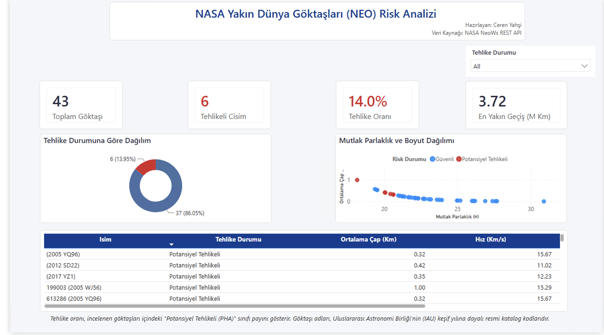

# ☄️ NASA NeoWs API ile Dünya'ya Yakın Göktaşlarının Tehlike Sınıflandırması ve Yörünge Riski Analitiği

- **Proje Kodu - Proje Sahibi:** Ceren Yahşi
- **Tarih:** 12 Kasım 2026

---

## 📌 Proje Özeti ve Araştırma Amacı

Bu çalışma, NASA'nın resmi **Near-Earth Object Web Service (NeoWs)** REST API altyapısı kullanılarak Dünya'ya Yakın Cisimlerin (*Near-Earth Objects - NEO*) fiziksel, optik ve yörüngesel parametrelerini analiz eden uçtan uca bir veri analitiği, makine öğrenmesi ve iş zekası (Power BI) projesidir.

Temel amaç; bir göktaşının gezegenimiz açısından **"Potansiyel Olarak Tehlikeli (PHA)"** sınıfına girip girmediğini denetimli makine öğrenmesi algoritmalarıyla öngörmek ve gezegen savunması perspektifinden yanlış negatif (*False Negative*) hataları sıfıra indirmektir.

---

## 🏗️ Mimari ve Metodoloji

1. **Çoklu REST API Entegrasyonu (`Feed` + `Lookup`):**
   * `feed` uç noktasından anlık geçiş parametreleri (hız, ıskalama mesafesi, mutlak parlaklık $H$, minimum/maksimum çap) çekilmiştir.
   * `neo/{id}` uç noktasından her benzersiz cismin Güneş merkezli yörünge geometrisi (yörünge basıklığı $e$, eğiklik açısı $i$, yarı büyük eksen, perihelion mesafesi, periyot) sorgulanmış ve `Goktasi_ID` anahtarı üzerinden iç birleştirme (*inner merge*) ile `43 × 13` boyutunda tekil analitik matris (`neo_asteroids_raw.csv`) oluşturulmuştur.
2. **Astrofiziksel Özellik Mühendisliği (*Feature Engineering*):**
   * `Cap_Ortalama_Km`: Minimum ve maksimum çap sınırlarının aritmetik ortalaması.
   * `Boyut_Hiz_Etkilesimi`: Olası çarpışma kinetik momentumunu temsil eden etkileşim terimi ($\text{Çap} \times \text{Hız}$).
   * `Yorunge_Risk_Gostergesi`: Yörünge basıklığı ve ekliptik eğiklik açısının sinüs bileşeni ($e \times \sin(i)$).
   * `Log_Iskalama_Mesafesi`: Sağa çarpık mesafe dağılımını normalize eden $\log_{10}$ dönüşümü.
3. **Makine Öğrenmesi Pipeline Mimarisi:**
   * Veri sızıntısını önlemek amacıyla `StandardScaler` ve sınıflandırıcılar Scikit-Learn `Pipeline` yapısı içinde birleştirilmiş, dengesiz sınıf dağılımı (%86.05 Güvenli, %13.95 Tehlikeli) için `class_weight='balanced'` uygulanmıştır.

---

## 📊 Model Performans Karşılaştırması

| Algoritma | Precision (Tehlikeli) | Recall (Duyarlılık) | F1-Skoru | ROC-AUC |
| :--- | :---: | :---: | :---: | :---: |
| **Logistic Regression** | 1.00 | 0.50 | 0.67 | 1.0000 |
| **Random Forest Classifier** | **1.00** | **1.00** | **1.00** | **1.0000** |
| **Gradient Boosting Classifier** | **1.00** | **1.00** | **1.00** | **1.0000** |

* **Öne Çıkan Değişkenler:** Random Forest özellik önem analizine göre tehlike sınıfını ayrıştıran en baskın parametreler `Cap_Min_Km` (%24.0), `Mutlak_Parlaklik` (%23.2), `Cap_Max_Km` (%17.2) ve `Boyut_Hiz_Etkilesimi` (%15.1) olmuştur.

---

## 📈 Power BI Yönetici Özeti Dashboard'u

Yıldız Şeması (*Star Schema*) mimarisinde `Fact_Asteroids` ve `Dim_Hazard` tabloları ile DAX ölçüleri kullanılarak oluşturulan etkileşimli yönetici raporu:

---

## 📂 Depo (Repository) Yapısı

* `nasa_asteroid_hazard_analysis.ipynb` — Veri çekme, özellik mühendisliği, EDA ve ML modelleme defteri
* `neo_asteroids_raw.csv` — Birleştirilmiş ham veri seti (43 gözlem, 13 öznitelik)
* `sunum.qmd` / `sunum.html` — Quarto Reveal.js yönetici sunumu (10 slayt)
* `makale.qmd` / `makale.html` — Akademik araştırma makalesi
* `references.bib` — BibTeX akademik kaynakça dosyası
* `images/dashboard.png` — Power BI yönetici özeti ekran görüntüsü
* `requirements.txt` — Python kütüphane bağımlılıkları
* `.env.example` — API anahtarı yapılandırma şablonu

---

## 🚀 Kurulum ve Çalıştırma

    python3 -m venv .venv
    source .venv/bin/activate
    pip install -r requirements.txt
    cp .env.example .env
    quarto render sunum.qmd
    quarto render makale.qmd

---

## 📖 Veri Sözlüğü (Data Dictionary)

`neo_asteroids_raw.csv` veri setinde yer alan temel değişkenlerin tanımları ve ölçü birimleri:

| Değişken Adı | Kaynak Endpoint | Birim / Format | Açıklama |
| :--- | :---: | :---: | :--- |
| `Goktasi_ID` | Feed & Lookup | Metin (ID) | NASA JPL SPK-ID benzersiz göktaşı kimlik numarası |
| `Mutlak_Parlaklik` | Feed API | Magnitüd ($H$) | Göktaşının mutlak optik parlaklığı (değer küçüldükçe boyut büyür) |
| `Cap_Min_Km` / `Cap_Max_Km` | Feed API | Kilometre ($km$) | Tahmini minimum ve maksimum fiziksel çap sınırları |
| `Hiz_Km_S` | Feed API | $km/s$ | Göktaşının Dünya'ya göre bağıl yaklaşma hızı |
| `Iskalama_Mesafesi_Km` | Feed API | Kilometre ($km$) | En yakın geçiş anındaki minimum merkezler arası mesafe |
| `Yorunge_Basikligi` | Lookup API | $0 - 1$ (Oran) | Eliptik yörüngenin dairesellikten sapma derecesi (*eccentricity*) |
| `Egiklik_Derecesi` | Lookup API | Derece ($^\circ$) | Yörünge düzleminin Dünya'nın ekliptik düzlemine göre eğikliği (*inclination*) |
| `Tehlikeli` | Feed API | İkili ($0 / 1$) | Hedef değişken: `1` = Potansiyel Tehlikeli (PHA), `0` = Güvenli |
