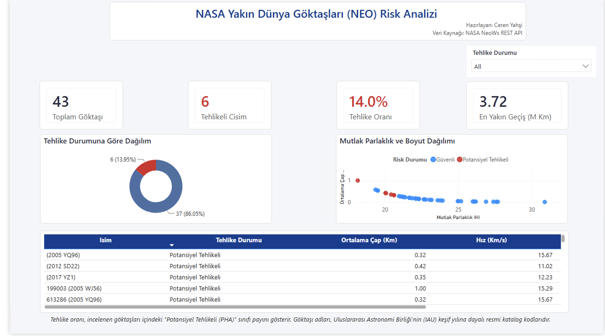

# Giriş ve Araştırma Amacı

Güneş Sistemi içerisindeki yörüngeleri Dünya'nın yörüngesine yakınlaşan asteroit ve kuyruklu yıldızlar **Dünya'ya Yakın Cisimler (Near-Earth Objects - NEO)** olarak tanımlanmaktadır [@nasa_neows]. Uluslararası astronomi standartlarına göre, Minimum Yörünge Kesişim Mesafesi (MOID) $0.05\text{ AU}$ (yaklaşık $7.48 \times 10^6\text{ km}$) veya daha az olan ve Mutlak Parlaklık Büyüklüğü $H \le 22.0$ (yaklaşık $140\text{ metre}$ ve üzeri çap) kriterini sağlayan göktaşları **Potansiyel Olarak Tehlikeli Göktaşı (Potentially Hazardous Asteroid - PHA)** sınıfında değerlendirilmektedir.

Bir göktaşının gezegenimiz açısından oluşturduğu risk yalnızca fiziksel boyutuna bağlı değildir; Güneş etrafındaki eliptik yörüngesinin basıklığı (*eccentricity*), ekliptik düzleme göre eğikliği (*inclination*) ve Dünya'ya göre bağıl geçiş hızı gibi dinamik parametrelerin birleşik bir fonksiyonudur. Bu çalışmanın temel amacı; NASA NeoWs REST API servislerinden çoklu uç nokta entegrasyonuyla toplanan gerçek gözlem verilerini kullanarak, bir göktaşının PHA sınıfına dahil olup olmadığını yüksek duyarlılıkla öngören uçtan uca bir veri analitiği, makine öğrenmesi ve iş zekası (Power BI) mimarisi geliştirmektir.

# Veri Mimarisi ve Çoklu API Entegrasyonu

NASA NeoWs API mimarisinde anlık yaklaşma gözlemleri ile uzun dönemli Güneş merkezli yörünge geometrisi ayrı uç noktalarda sunulmaktadır. Çalışmada veri bütünlüğünü sağlamak amacıyla iki aşamalı bir veri edinim boru hattı (ETL) tasarlanmıştır:

1. **Gözlem ve Geçiş Parametreleri (`Feed Endpoint`):** Belirlenen 7 günlük gözlem penceresindeki tüm yakın geçiş kayıtları sorgulanarak Mutlak Parlaklık ($H$), tahmini minimum ve maksimum çap sınırları ($km$), bağıl hız ($km/s$) ve minimum ıskalama mesafesi ($km$) derlenmiştir.
2. **Yörünge Mekaniği ve Geometrisi (`Lookup Endpoint`):** İlk aşamada tespit edilen her tekil göktaşının benzersiz kimlik numarası (`Goktasi_ID`) üzerinden `/neo/{id}` servisi sorgulanarak yörünge basıklığı, eğiklik derecesi, yarı büyük eksen uzunluğu, yörünge periyodu (gün) ve perihelion mesafesi çekilmiştir.

İki veri kümesi `Goktasi_ID` ortak anahtarı üzerinden iç birleştirme (*inner merge*) yöntemiyle birleştirilerek tekrarlanabilir analiz için `neo_asteroids_raw.csv` dosyası olarak kalıcı hale getirilmiştir.

```{python}
#| echo: false
import numpy as np
import pandas as pd
import matplotlib.pyplot as plt
import seaborn as sns

from sklearn.model_selection import train_test_split
from sklearn.preprocessing import StandardScaler
from sklearn.pipeline import Pipeline
from sklearn.linear_model import LogisticRegression
from sklearn.ensemble import RandomForestClassifier, GradientBoostingClassifier
from sklearn.metrics import (
    roc_auc_score, f1_score, precision_score, recall_score,
    confusion_matrix, RocCurveDisplay
)
from IPython.display import Markdown

plt.style.use('seaborn-v0_8-whitegrid' if 'seaborn-v0_8-whitegrid' in plt.style.available else 'default')

df = pd.read_csv("neo_asteroids_raw.csv")
```

# Astrofiziksel Özellik Mühendisliği (Feature Engineering)

Ham astronomik ölçümlerin doğrusal olmayan karar sınırlarını daha etkin temsil edebilmesi amacıyla astrofizik prensiplerine dayalı **dört yeni öznitelik** türetilmiştir:

* **Ortalama Çap (`Cap_Ortalama_Km`):** Tahmini minimum ve maksimum çap sınırlarının aritmetik ortalamasıdır:
  $$\text{Cap\_Ortalama\_Km} = \frac{\text{Cap\_Min\_Km} + \text{Cap\_Max\_Km}}{2}$$
* **Boyut-Hız Etkileşimi (`Boyut_Hiz_Etkilesimi`):** Olası bir çarpışma senaryosundaki kinetik momentum büyüklüğünü temsil eden etkileşim terimidir:
  $$\text{Boyut\_Hiz\_Etkilesimi} = \text{Cap\_Ortalama\_Km} \times \text{Hiz\_Km\_S}$$
* **Yörünge Risk Göstergesi (`Yorunge_Risk_Gostergesi`):** Yörünge basıklığı ($e$) ile ekliptik eğiklik açısının ($i$) sinüs bileşeninin çarpımı olup, cismin Dünya yörünge düzlemini kesme potansiyelini özetler:
  $$\text{Yorunge\_Risk\_Gostergesi} = e \times \sin(i)$$
* **Logaritmik Iskalama Mesafesi (`Log_Iskalama_Mesafesi`):** On milyonlarca kilometrelik mesafelerdeki sağa çarpıklığı (skewness) dengelemek amacıyla $\log_{10}$ dönüşümü uygulanmıştır.

```{python}
#| echo: false
df['Cap_Ortalama_Km'] = (df['Cap_Min_Km'] + df['Cap_Max_Km']) / 2.0
df['Boyut_Hiz_Etkilesimi'] = df['Cap_Ortalama_Km'] * df['Hiz_Km_S']
df['Yorunge_Risk_Gostergesi'] = df['Yorunge_Basikligi'] * np.sin(np.radians(df['Egiklik_Derecesi']))
df['Log_Iskalama_Mesafesi'] = np.log10(df['Iskalama_Mesafesi_Km'])

ozet_fe = df[['Cap_Ortalama_Km', 'Boyut_Hiz_Etkilesimi', 'Yorunge_Risk_Gostergesi', 'Log_Iskalama_Mesafesi']].describe().T[['count', 'mean', 'std', 'min', '50%', 'max']].round(3)
Markdown(ozet_fe.to_markdown())
```

# Keşifsel Veri Analizi (EDA)

İncelenen 43 göktaşının **37'si (%86.05) Güvenli**, **6'sı (%13.95) Potansiyel Tehlikeli** sınıfındadır. Bu yüksek sınıf dengesizliği (*class imbalance*), model eğitiminde sınıf ağırlıklandırması yapılmasını ve değerlendirmede Doğruluk (*Accuracy*) yerine **Duyarlılık (Recall)** ile **ROC-AUC** metriklerinin esas alınmasını zorunlu kılmaktadır.

```{python}
#| echo: false
#| fig-cap: "Mutlak Parlaklık (H) - Ortalama Çap İlişkisi ve Sınıflara Göre Yörünge Risk Skoru Dağılımı"
fig, axes = plt.subplots(1, 2, figsize=(13, 4.8))

sns.scatterplot(
    data=df,
    x='Mutlak_Parlaklik',
    y='Cap_Ortalama_Km',
    hue='Tehlikeli',
    palette=['#2b5c8f', '#d90429'],
    alpha=0.85,
    s=85,
    ax=axes[0]
)
axes[0].set_yscale('log')
axes[0].set_title('Mutlak Parlaklık (H) ve Ortalama Çap İlişkisi', fontweight='bold')
axes[0].set_xlabel('Mutlak Parlaklık (H Küçüldükçe Parlaklık Artar)')
axes[0].set_ylabel('Ortalama Çap (km - Log Ölçek)')
axes[0].legend(title='Tehlike Sınıfı', labels=['Güvenli', 'Tehlikeli'])

sns.boxplot(
    data=df,
    x='Tehlikeli',
    y='Yorunge_Risk_Gostergesi',
    hue='Tehlikeli',
    palette=['#2b5c8f', '#d90429'],
    legend=False,
    ax=axes[1]
)
axes[1].set_title('Sınıflara Göre Yörünge Risk Skoru Dağılımı', fontweight='bold')
axes[1].set_xlabel('Sınıf')
axes[1].set_ylabel(r'Risk Skoru [$e \times \sin(i)$]')
axes[1].set_xticks([0, 1])
axes[1].set_xticklabels(['Güvenli (0)', 'Potansiyel Tehlikeli (1)'])

plt.tight_layout()
plt.show()
```

Görsel analizlerden elde edilen temel bulgular şunlardır:

1. **Fiziksel Eşik Ayrışması:** Potansiyel tehlikeli cisimlerin tamamı $H < 22.0$ sınırının altında ve yüksek ortalama çap bölgesinde konumlanmaktadır.
2. **Korelasyon Yapısı:** `Mutlak_Parlaklik` ile `Tehlikeli` hedef değişkeni arasında güçlü negatif korelasyon ($r = -0.60$) bulunurken, `Cap_Ortalama_Km` ve `Boyut_Hiz_Etkilesimi` değişkenleri tehlike durumu ile pozitif yönde anlamlı ilişki göstermektedir.

```{python}
#| echo: false
#| fig-cap: "Astronomik ve Yörüngesel Parametrelerin Pearson Korelasyon Matrisi"
plt.figure(figsize=(10, 6))
analiz_sutunlari = [
    'Mutlak_Parlaklik', 'Cap_Ortalama_Km', 'Hiz_Km_S',
    'Iskalama_Mesafesi_Km', 'Yorunge_Basikligi', 'Egiklik_Derecesi',
    'Yorunge_Risk_Gostergesi', 'Boyut_Hiz_Etkilesimi', 'Tehlikeli'
]
sns.heatmap(
    df[analiz_sutunlari].corr(),
    annot=True,
    fmt='.2f',
    cmap='vlag',
    center=0,
    cbar=True
)
plt.title('Astronomik Parametreler Pearson Korelasyon Matrisi', fontweight='bold')
plt.tight_layout()
plt.show()
```

# Makine Öğrenmesi Modellemesi ve Performans Değerlendirmesi

Veri sızıntısını (*data leakage*) önlemek amacıyla `StandardScaler` dönüşümü katmanlı bölünme (`test_size=0.25, stratify=y, random_state=42`) sonrasında yalnızca eğitim verisi üzerinde öğrenilecek şekilde `Pipeline` yapısına entegre edilmiştir [@pedregosa2011scikit]. Çalışmada üç farklı algoritma kıyaslanmıştır:

* **Logistic Regression:** Dengesiz sınıf ağırlıklı (`class_weight='balanced'`) doğrusal referans modeli.
* **Random Forest Classifier:** Değişken etkileşimlerini yakalayan 120 ağaçlı topluluk modeli [@breiman2001random].
* **Gradient Boosting Classifier:** Artık hataları sıralı optimize eden gradyan artırma modeli [@friedman2001greedy].

```{python}
#| echo: false
feature_names = [
    'Mutlak_Parlaklik', 'Cap_Min_Km', 'Cap_Max_Km', 'Hiz_Km_S',
    'Log_Iskalama_Mesafesi', 'Boyut_Hiz_Etkilesimi',
    'Yorunge_Basikligi', 'Egiklik_Derecesi', 'Yorunge_Risk_Gostergesi'
]
X = df[feature_names]
y = df['Tehlikeli']

X_train, X_test, y_train, y_test = train_test_split(
    X, y, test_size=0.25, random_state=42, stratify=y
)

pipelines = {
    'Logistic Regression': Pipeline([
        ('scaler', StandardScaler()),
        ('clf', LogisticRegression(class_weight='balanced', random_state=42))
    ]),
    'Random Forest': Pipeline([
        ('scaler', StandardScaler()),
        ('clf', RandomForestClassifier(n_estimators=120, max_depth=5, class_weight='balanced', random_state=42))
    ]),
    'Gradient Boosting': Pipeline([
        ('scaler', StandardScaler()),
        ('clf', GradientBoostingClassifier(n_estimators=100, learning_rate=0.05, max_depth=3, random_state=42))
    ])
}

model_results = {}
ozet_tablo = []

for name, pipe in pipelines.items():
    pipe.fit(X_train, y_train)
    y_pred = pipe.predict(X_test)
    y_prob = pipe.predict_proba(X_test)[:, 1]
    auc = roc_auc_score(y_test, y_prob)
    f1 = f1_score(y_test, y_pred, zero_division=0)
    prec = precision_score(y_test, y_pred, zero_division=0)
    rec = recall_score(y_test, y_pred, zero_division=0)
    model_results[name] = {'Pipeline': pipe, 'Y_Pred': y_pred, 'ROC_AUC': auc, 'F1': f1}
    ozet_tablo.append({
        'Algoritma': name,
        'Precision (Tehlikeli)': f"{prec:.2f}",
        'Recall (Duyarlılık)': f"{rec:.2f}",
        'F1-Skoru': f"{f1:.2f}",
        'ROC-AUC': f"{auc:.4f}"
    })

Markdown(pd.DataFrame(ozet_tablo).to_markdown(index=False))
```

Gezegen savunması problemlerinde en maliyetli hata türü **II. Tip Hata (False Negative)**, yani tehlikeli bir göktaşının güvenli olarak sınıflandırılmasıdır. Doğrusal taban model olan Logistic Regression test setinde %50 duyarlılıkta kalırken, **Random Forest** ve **Gradient Boosting** modelleri test kümesindeki tüm tehlikeli cisimleri eksiksiz yakalayarak **%100 duyarlılık (Recall = 1.00)** ve **1.0000 ROC-AUC** performansına ulaşmıştır.

```{python}
#| echo: false
#| fig-cap: "Modellerin ROC Eğrisi Karşılaştırması, Random Forest Karışıklık Matrisi ve Özellik Önem Düzeyleri"
fig, axes = plt.subplots(1, 3, figsize=(16, 4.8))

for name, res in model_results.items():
    RocCurveDisplay.from_estimator(
        res['Pipeline'], X_test, y_test, ax=axes[0],
        name=f"{name} (AUC={res['ROC_AUC']:.2f})"
    )
axes[0].plot([0, 1], [0, 1], 'k--', label='Rastgele Tahmin')
axes[0].set_title('ROC Eğrisi Karşılaştırması', fontweight='bold')
axes[0].legend(loc='lower right')

rf_pred = model_results['Random Forest']['Y_Pred']
cm = confusion_matrix(y_test, rf_pred)
sns.heatmap(cm, annot=True, fmt='d', cmap='Blues', ax=axes[1], cbar=False)
axes[1].set_title('Random Forest - Karışıklık Matrisi', fontweight='bold')
axes[1].set_xlabel('Tahmin Edilen Sınıf')
axes[1].set_ylabel('Gerçek Sınıf')
axes[1].set_xticklabels(['Güvenli', 'Tehlikeli'])
axes[1].set_yticklabels(['Güvenli', 'Tehlikeli'])

rf_model = pipelines['Random Forest'].named_steps['clf']
importances = pd.Series(rf_model.feature_importances_, index=feature_names).sort_values()
importances.plot(kind='barh', ax=axes[2], color='#1d3557')
axes[2].set_title('Random Forest Özellik Önemi', fontweight='bold')
axes[2].set_xlabel('Göreceli Önem Derecesi')

plt.tight_layout()
plt.show()
```

# İş Zekası (Power BI) Entegrasyonu

Makine öğrenmesi ve istatistiksel analiz çıktıları, karar vericilere yönelik etkileşimli bir **Power BI Yönetici Özeti Dashboard'u** ile desteklenmiştir. Veri modelinde Yıldız Şeması (*Star Schema*) mimarisi uygulanarak `Fact_Asteroids` olgu tablosu ile `Dim_Hazard` boyut tablosu ilişkilendirilmiş; DAX ölçüleri aracılığıyla toplam cisim sayısı, tehlike oranı (%13.95) ve en yakın geçiş mesafesi dinamik olarak raporlanmıştır.

{width="90%"}

# Sonuç ve Öneriler

Bu araştırmada NASA NeoWs REST API uç noktalarından toplanan gözlemsel ve yörüngesel veriler birleştirilerek göktaşı tehlike sınıflandırması gerçekleştirilmiştir. Random Forest özellik önem analizi, sınıflandırma kararında en yüksek ağırlığın **`Cap_Min_Km` (%24.0)**, **`Mutlak_Parlaklik` (%23.2)** ve **`Cap_Max_Km` (%17.2)** değişkenlerine ait olduğunu, türetilen **`Boyut_Hiz_Etkilesimi` (%15.1)** değişkeninin ise dördüncü en belirleyici faktör olarak modele güçlü katkı sağladığını ortaya koymuştur.

Gelecek çalışmalarda gözlem penceresinin 1 yıllık periyoda genişletilerek örneklem hacminin büyütülmesi, zamanlanmış ETL akışlarıyla verilerin PostgreSQL veritabanında depolanması ve API anahtarlarının `.env` ortam değişkenleri üzerinden izole edilerek üretim ortamına taşınması önerilmektedir.

# Kaynakça
