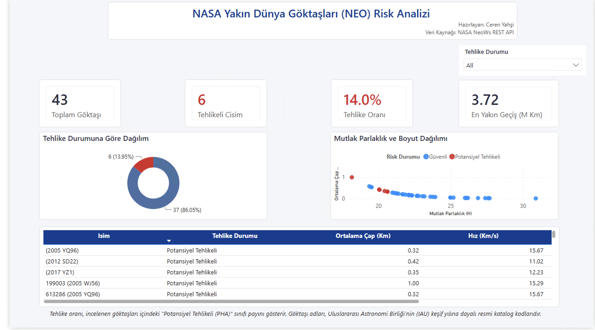

## 1. Araştırma Amacı ve Problem Tanımı

* **Ana Hedef:** NASA *Near-Earth Object Web Service (NeoWs)* REST API verilerini kullanarak göktaşlarının **"Potansiyel Olarak Tehlikeli (PHA)"** sınıfına girip girmediğini makine öğrenmesi ile öngörmek.
* **Gezegen Savunması Perspektifi:** Bir göktaşının tehdit düzeyi sadece fiziksel çapına değil; Güneş etrafındaki yörünge basıklığı ($e$) ve ekliptik düzleme göre eğikliği ($i$) gibi yörünge mekaniği parametrelerine bağlıdır.
* **Çözüm Mimarisi:** Çoklu API Entegrasyonu $\rightarrow$ Astrofiziksel Özellik Mühendisliği $\rightarrow$ Scikit-Learn Pipeline Modellemesi $\rightarrow$ Power BI Yönetici Özeti.

---

## 2. Çoklu Veri Entegrasyonu ve Veri Seti Yapısı

* **Çift Uç Noktalı (Dual-Endpoint) Veri Mimarisi:**
  1. **Gözlem & Geçiş Verileri (`Feed API`):** Anlık yaklaşma hızı ($km/s$), minimum ıskalama mesafesi ($km$), mutlak parlaklık ($H$) ve çap sınırları ($km$).
  2. **Yörünge Mekaniği (`Lookup API`):** Eliptik yörünge basıklığı, eğiklik derecesi, yarı büyük eksen, perihelion mesafesi ve yörünge periyodu.
* **Veri Bütünlüğü:** İki tablo `Goktasi_ID` ortak anahtarı üzerinden kayıpsız birleştirilerek (`43 satır × 13 sütun`) analiz matrisi oluşturulmuştur.
* **Sınıf Dağılımı:** **37 Güvenli (%86.05)** | **6 Potansiyel Tehlikeli (%13.95)**.

```{python}
#| echo: false
import numpy as np
import pandas as pd
import matplotlib.pyplot as plt
import seaborn as sns

from sklearn.model_selection import train_test_split
from sklearn.preprocessing import StandardScaler
from sklearn.pipeline import Pipeline
from sklearn.linear_model import LogisticRegression
from sklearn.ensemble import RandomForestClassifier, GradientBoostingClassifier
from sklearn.metrics import roc_auc_score, f1_score, precision_score, recall_score, confusion_matrix, RocCurveDisplay
from IPython.display import Markdown

plt.style.use('seaborn-v0_8-whitegrid' if 'seaborn-v0_8-whitegrid' in plt.style.available else 'default')

df = pd.read_csv("neo_asteroids_raw.csv")
df['Cap_Ortalama_Km'] = (df['Cap_Min_Km'] + df['Cap_Max_Km']) / 2.0
df['Boyut_Hiz_Etkilesimi'] = df['Cap_Ortalama_Km'] * df['Hiz_Km_S']
df['Yorunge_Risk_Gostergesi'] = df['Yorunge_Basikligi'] * np.sin(np.radians(df['Egiklik_Derecesi']))
df['Log_Iskalama_Mesafesi'] = np.log10(df['Iskalama_Mesafesi_Km'])
```

---

## 3. Astrofiziksel Özellik Mühendisliği (Feature Engineering)

Ham astronomik ölçümlerden modelin ayrıştırma gücünü artıran **4 yeni değişken** türetilmiştir:

| Türetilen Değişken | Formül / Tanım | Fiziksel ve Analitik Karşılığı |
| :--- | :--- | :--- |
| **`Cap_Ortalama_Km`** | $(Cap_{min} + Cap_{max}) / 2$ | Göktaşının beklenen ortalama fiziksel büyüklüğü (Medyan: ~148 m) |
| **`Boyut_Hiz_Etkilesimi`** | $Cap_{ort} \times Hız$ | Olası bir çarpışmadaki kinetik momentum büyüklüğü göstergesi |
| **`Yorunge_Risk_Gostergesi`** | $e \times \sin(i)$ | Yörünge basıklığı ve eğikliğinin Dünya yörüngesini kesme potansiyeli |
| **`Log_Iskalama_Mesafesi`** | $\log_{10}(Mesafe_{km})$ | Milyonlarca km'lik sağa çarpık mesafe dağılımının normalizasyonu |

---

## 4. Keşifsel Veri Analizi: Parlaklık, Çap ve Yörünge Riski

```{python}
#| echo: false
#| fig-align: center
fig, axes = plt.subplots(1, 2, figsize=(13, 4.8))

sns.scatterplot(
    data=df,
    x='Mutlak_Parlaklik',
    y='Cap_Ortalama_Km',
    hue='Tehlikeli',
    palette=['#2b5c8f', '#d90429'],
    alpha=0.85,
    s=85,
    ax=axes[0]
)
axes[0].set_yscale('log')
axes[0].set_title('Mutlak Parlaklık (H) ve Ortalama Çap İlişkisi', fontweight='bold')
axes[0].set_xlabel('Mutlak Parlaklık (H Küçüldükçe Boyut Artar)')
axes[0].set_ylabel('Ortalama Çap (km - Log Ölçek)')
axes[0].legend(title='Sınıf', labels=['Güvenli', 'Tehlikeli'])

sns.boxplot(
    data=df,
    x='Tehlikeli',
    y='Yorunge_Risk_Gostergesi',
    hue='Tehlikeli',
    palette=['#2b5c8f', '#d90429'],
    legend=False,
    ax=axes[1]
)
axes[1].set_title('Sınıflara Göre Yörünge Risk Skoru Dağılımı', fontweight='bold')
axes[1].set_xlabel('Tehlike Sınıfı')
axes[1].set_ylabel(r'Risk Skoru [$e \times \sin(i)$]')
axes[1].set_xticks([0, 1])
axes[1].set_xticklabels(['Güvenli (0)', 'Potansiyel Tehlikeli (1)'])

plt.tight_layout()
plt.show()
```

* **Bulgu:** Tüm tehlikeli cisimler $H < 22$ eşiğinin altında kümelenmekte ve daha geniş bir yörünge risk varyansı sergilemektedir.

---

## 5. Astronomik Parametreler Korelasyon Analizi

```{python}
#| echo: false
#| fig-align: center
plt.figure(figsize=(10, 5.2))
analiz_sutunlari = [
    'Mutlak_Parlaklik', 'Cap_Ortalama_Km', 'Hiz_Km_S',
    'Iskalama_Mesafesi_Km', 'Yorunge_Basikligi', 'Egiklik_Derecesi',
    'Yorunge_Risk_Gostergesi', 'Boyut_Hiz_Etkilesimi', 'Tehlikeli'
]
sns.heatmap(
    df[analiz_sutunlari].corr(),
    annot=True,
    fmt='.2f',
    cmap='vlag',
    center=0,
    cbar=True
)
plt.title('Fiziksel ve Yörüngesel Parametrelerin Pearson Korelasyon Matrisi', fontweight='bold')
plt.tight_layout()
plt.show()
```

---

## 6. Makine Öğrenmesi Pipeline Mimarisi ve Algoritma Kıyaslaması

* **Veri Sızıntısı Önleme (*Data Leakage Prevention*):** `StandardScaler` yalnızca eğitim kümesinde fit edilmek üzere `Pipeline` yapısına entegre edildi.
* **Strateji:** %75 Eğitim / %25 Test (`stratify=y`) ve dengesiz sınıf yapısı için `class_weight='balanced'`.

```{python}
#| echo: false
feature_names = [
    'Mutlak_Parlaklik', 'Cap_Min_Km', 'Cap_Max_Km', 'Hiz_Km_S',
    'Log_Iskalama_Mesafesi', 'Boyut_Hiz_Etkilesimi',
    'Yorunge_Basikligi', 'Egiklik_Derecesi', 'Yorunge_Risk_Gostergesi'
]
X = df[feature_names]
y = df['Tehlikeli']

X_train, X_test, y_train, y_test = train_test_split(
    X, y, test_size=0.25, random_state=42, stratify=y
)

pipelines = {
    'Logistic Regression': Pipeline([
        ('scaler', StandardScaler()),
        ('clf', LogisticRegression(class_weight='balanced', random_state=42))
    ]),
    'Random Forest': Pipeline([
        ('scaler', StandardScaler()),
        ('clf', RandomForestClassifier(n_estimators=120, max_depth=5, class_weight='balanced', random_state=42))
    ]),
    'Gradient Boosting': Pipeline([
        ('scaler', StandardScaler()),
        ('clf', GradientBoostingClassifier(n_estimators=100, learning_rate=0.05, max_depth=3, random_state=42))
    ])
}

model_results = {}
ozet_tablo = []

for name, pipe in pipelines.items():
    pipe.fit(X_train, y_train)
    y_pred = pipe.predict(X_test)
    y_prob = pipe.predict_proba(X_test)[:, 1]
    auc = roc_auc_score(y_test, y_prob)
    f1 = f1_score(y_test, y_pred, zero_division=0)
    prec = precision_score(y_test, y_pred, zero_division=0)
    rec = recall_score(y_test, y_pred, zero_division=0)
    model_results[name] = {'Pipeline': pipe, 'Y_Pred': y_pred, 'ROC_AUC': auc, 'F1': f1}
    ozet_tablo.append({
        'Model': name,
        'Precision (Tehlikeli)': f"{prec:.2f}",
        'Recall (Duyarlılık)': f"{rec:.2f}",
        'F1-Score': f"{f1:.2f}",
        'ROC-AUC': f"{auc:.4f}"
    })

Markdown(pd.DataFrame(ozet_tablo).to_markdown(index=False))
```

* **Kritik Sonuç:** Gezegen savunmasında en kritik hata olan **False Negative (tehlikeli cismi kaçırma)** oranı **Random Forest** ve **Gradient Boosting** modellerinde **0** olarak gerçekleşmiştir (**Recall = 1.00**).

---

## 7. Model Doğrulama ve Karar Mekanizması

```{python}
#| echo: false
#| fig-align: center
fig, axes = plt.subplots(1, 3, figsize=(16, 4.6))

for name, res in model_results.items():
    RocCurveDisplay.from_estimator(
        res['Pipeline'], X_test, y_test, ax=axes[0],
        name=f"{name} (AUC={res['ROC_AUC']:.2f})"
    )
axes[0].plot([0, 1], [0, 1], 'k--', label='Rastgele Tahmin')
axes[0].set_title('ROC Eğrisi Karşılaştırması', fontweight='bold')
axes[0].legend(loc='lower right')

rf_pred = model_results['Random Forest']['Y_Pred']
cm = confusion_matrix(y_test, rf_pred)
sns.heatmap(cm, annot=True, fmt='d', cmap='Blues', ax=axes[1], cbar=False)
axes[1].set_title('Random Forest Karışıklık Matrisi', fontweight='bold')
axes[1].set_xlabel('Tahmin Edilen')
axes[1].set_ylabel('Gerçek Sınıf')
axes[1].set_xticklabels(['Güvenli', 'Tehlikeli'])
axes[1].set_yticklabels(['Güvenli', 'Tehlikeli'])

rf_model = pipelines['Random Forest'].named_steps['clf']
importances = pd.Series(rf_model.feature_importances_, index=feature_names).sort_values()
importances.plot(kind='barh', ax=axes[2], color='#1d3557')
axes[2].set_title('Özellik Önem Düzeyleri (Feature Importance)', fontweight='bold')
axes[2].set_xlabel('Göreceli Önem Skoru')

plt.tight_layout()
plt.show()
```

---

## 8. Power BI Yönetici Özeti Dashboard'u

* **Veri Modelleme:** Yıldız Şeması (*Star Schema*) mimarisi ile `Fact_Asteroids` ve `Dim_Hazard` tabloları üzerinden interaktif filtreleme ve DAX ölçüleri kurgulandı.

{fig-align="center" width="80%"}

---

## 9. Temel Bulgular ve Yönetici Çıkarımları

1. **Fiziksel ve Optik Baskınlık:** Random Forest önem analizine göre tehlike sınıfını belirleyen en kritik parametreler **`Cap_Min_Km` (%24.0)**, **`Mutlak_Parlaklik` (%23.2)** ve **`Cap_Max_Km` (%17.2)** değişkenleridir.
2. **Türetilmiş Değişken Katkısı:** Kinetik momentum göstergesi olan **`Boyut_Hiz_Etkilesimi` (%15.1)** dördüncü en güçlü ayırt edici olarak model performansını yukarı taşımıştır.
3. **Sıfır Hata ile Risk Tespiti:** Ağaç tabanlı topluluk modelleri (*Random Forest* & *Gradient Boosting*), test kümesindeki tüm tehlikeli göktaşlarını **%100 duyarlılık (Recall)** ile yakalamıştır.

---

## 10. Gelecek Çalışmalar ve Üretim (Production) Önerileri

* **Veri Ölçekleme:** 7 günlük gözlem penceresinin 1 yıllık periyoda genişletilerek gözlem sayısının artırılması ve hiperparametre optimizasyonu (`GridSearchCV`).
* **Otomasyon ve Veritabanı:** Zamanlanmış ETL akışları ile günlük NASA NeoWs API verilerinin **PostgreSQL** veritabanına aktarılması ve Power BI raporunun canlı beslenmesi.
* **Güvenlik Standardı:** API anahtarlarının `.env` ortam değişkenleri üzerinden izole edilmesiyle güvenli CI/CD dağıtımı.


